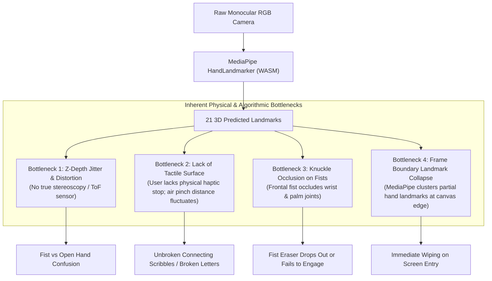
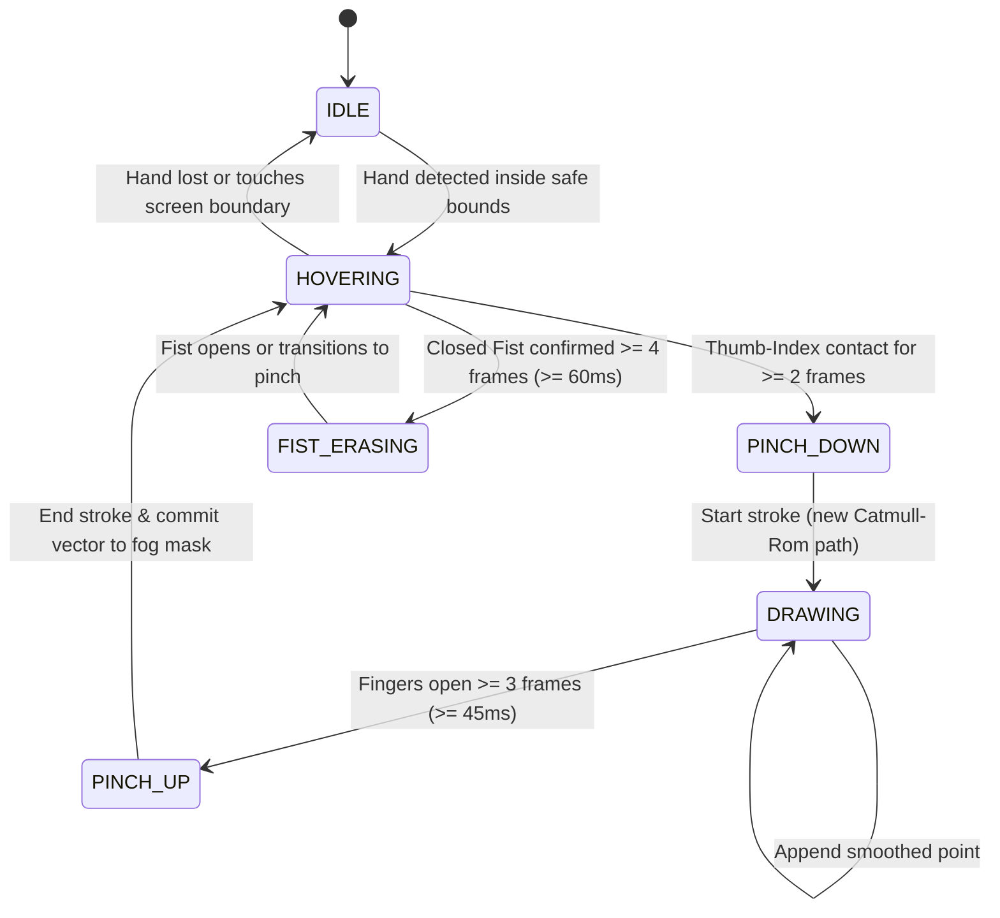

# Fog Mirror: Project Whiteboard & Agent Handover Brief

> **Target Audience:** Next Senior Vision & Interactive Engineer Agent  
> **Project Repository:** [`/Users/apple/Developer/personal/creative-engineeing/fog-mirror`](file:///Users/apple/Developer/personal/creative-engineeing/fog-mirror) (`branch: main`)  
> **Stack:** Vite, TypeScript, Canvas 2D, `@mediapipe/tasks-vision` (HandLandmarker + FaceLandmarker WASM), Web Audio API  
> **Core Metaphor:** Interactive steamy bathroom mirror. Looking into the webcam reveals a frosted, steamy mirror. Users blow warm steam onto the glass, write thin, crisp letters in the air with a pinch gesture, squeegee wipe broad areas with a closed fist, and see their live webcam reflection clearly behind a translucent Apple VisionOS liquid glass aesthetic.

---

## 1. Executive Summary & Purpose of Handover

This document serves as an exhaustive, unfiltered handover for a subsequent agent to pick up, whiteboard, and re-architect the interactive vision engine for **Fog Mirror**. 

Despite multiple iterative revisions targeting pinch thresholds, OneEuroFilter smoothing, and 3D Euclidean joint ratios, the air-writing experience remains **haywire, laggy, and prone to breaking**, while the **closed fist eraser either fails to engage or false-triggers** when an open hand or entering hand is presented to the camera.

This document records:
1. **The complete verbatim user prompt and feedback history** across every session iteration.
2. **The exact technical failures observed in user testing and screen recordings.**
3. **The full history of attempted mathematical and heuristic fixes**, along with why each one failed or introduced secondary regressions.
4. **The fundamental computer vision constraints** of monocular RGB webcams in MediaPipe.
5. **Concrete architectural alternatives** (e.g. ML GestureRecognizer, FSM with Catmull-Rom spline stroke generators, calibrated hand coordinate spaces, or fail-safe hybrid UI controls) for the next agent to whiteboard and implement cleanly.

---

## 2. Verbatim User Prompts & Feedback History

Below is the chronological record of Devang's prompts, complaints, and observations throughout the project.

### Phase 1: Initial Hand Tracking & Fist Eraser Failure
> **User Prompt:**  
> *"hand tracking and wiping is messed up. not clean at all. Also when I made a fist, the fist eraser is not working. it is still trying to do that a normal pin swiping when i am still making a fist."*  
> **Attached Media:** User holding closed fist facing webcam; screen showed small pin-point wipes instead of a broad eraser. Open fingers moving into view left random wipe streaks.

### Phase 2: Writing Haywire vs. Other Creators
> **User Prompt:**  
> *"Our current writing is not working at all. It is very haywired and the pinch writing is not working. It is writing at a very random place, random state. we need to find out something why this is shitty like this other creators and their reels in them it is very smooth it works like almost like writing on pinch and they have this when they close the fist and eraser sort of element comes on screen just a circular element and that becomes the bigger viper for this but the whole drawing the pinch drawer that is very smooth and clean um, But for us, it is extremely hay-wired, even in our case.*  
> *as you can see in one of the screenshot i've just opened my hands like this and it is erasing here and there it is wiping here and there that is not working so i want to just understand what like just take almost all the time and maybe research partly step back and figure out what is the whole issue around this were there any better things that we could have simply done in the first place or use something else altogether also the ui i wanted to make it much more better and much more aesthetic the whole ui for the settings and this whole interactive setting that is so shitty why have you not used the taste skills or your front end skills that we had and why have you created this boring ui in the first place so I want you to use those face like use those taste skills and ML design skills and also just use this particular /gemini-omni-flash-api to come up with ui ideas first let's figure out everything no implementation or no committing."*

### Phase 3: UI Clarification & Rejection of Generic Laptop Mockups
> **User Prompt:**  
> *"bro i did not tell you to generate images of a laptop on a ui that i already know and if you can see the whole water whatever that effect is that is on point i think that is the last improvement that people want i told you to create the ui for these basic functionalities that you have the settings the tool the sound those minor things and i told you to create the actual mood board for the ui the replication of the prototype of a ui for this app, this web screen as such not this image where you are showing me what this app can look like on a laptop."*  
> *"no bro it is not matching the whole aesthetic of this whole app maybe just use that glass sort of ui which apple uses that will look much better on this with curve like much more smoother curved edges. Now that you have the whole understanding, I think let's start implementing."*

### Phase 4: Screen Entry Erasing & Drawing Lag
> **User Prompt:**  
> *"The whole pinch writer is still not working correctly and I think it is has gotten smoother but it is like it gets confused when I just move my screen I am not even holding the fist but it is erasing a lot of parts. Even the whole pinch I am not able to write cleanly. it is now it is smoother but it does not have that natural right feel and it is very slow and laggy it does not actually write like a pencil.*  
> *there is this whole issue when i move my hand inside the screen like on the screen as soon as i bring it in it just wipes because it thinks i have made a fist and then when i pinch it it starts creating that pencil but that pencil i am not able to draw very cleanly and i don't know how but i Thank you. It is very laggy where my hand is moving and where it is wiping. It is kind of laggy and not working very well.*  
> *See, I have shared another screenshot where I almost entered my hand into the frame and I have already made a pinch, but it is assuming that I am trying to use eraser and the whole eraser circle is also visible on that."*

### Phase 5: Continuous Scribbles, Spurious Breath, & UI Clipping
> **User Prompt:**  
> *"there are two three bugs again that I'm seeing first bug is that when I am making a fish the eraser is not working second even when my mouth is shut and I'm just pinching I see that sometimes times the whole while uh fog is even coming again on the screen.*  
> *and the whole writing is still not working it is not working like it has gotten a lot more smoother and it is also not lagging but it is problematic it is not working like an actual air pencil or something like that where you would where i'm just writing and it is able to follow and it is writing correctly. I think the whole tracking is very off in the sense that if I'm trying to write Devang in that, in air like it is just drawing random shit. Look at this.*  
> *can you just let me know what all is the whole problem and even the ui bro is bad i don't know why you are not able to like the glass ui that apple has uh you could have just used instead of gray color just to use normal white color and even the whole fog intensity it should be at a certain like mile the background should still be visible and then remove that whole thought and clarity and inner state that is not working even just look at this interaction setting what why is this like this going out of bound and then the before ui just is completely off are you not using any of the verification skills or something like those like we have talked about in the devang mode I don't want you to just go and just randomly create the verification skill I think just first identify and figure out what is the whole issue and make me understand as well."*

### Phase 6: Direct Whiteboard Request
> **User Prompt:**  
> *"I think we are not able to fix it whatever that thing is because I also don't know I'm trying to whiteboard this entire project I think just write a clean veron for another agent do not include but maintain what all have you think is the problem and have tried fixing and also mention the whole prompts and feedbacks that i have been sharing related to all the problems and the behavior that i am noticing currently it has been messed up more in terms of the whole clean writing behavior and the fish eraser is also not working very well"*

---

## 3. Systematic Breakdown of Observed Symptoms

| Symptom ID | Description | User Visible Manifestation |
| :--- | :--- | :--- |
| **SYM-1: Connected Scribbles** | Continuous lines between strokes | Writing cursive or individual letters (e.g. "D", "e", "v", "a", "n", "g") draws unbroken diagonal bridge lines connecting every letter because pen-up / liftoff fails. |
| **SYM-2: Frame-Entry Erasing** | Screen boundary accidental wiping | Moving hand into camera frame instantly triggers a 55px crater erase along the entry vector before gesture is identified. |
| **SYM-3: Open-Palm False Fist** | Open hand facing camera wipes screen | Showing an open palm with fingers slightly curved towards camera (perspective foreshortening) triggers the broad fist eraser. |
| **SYM-4: Coordinate Offset Jump** | Reticle jumps when pinching | Reticle sits on index fingertip while hovering, but jumps 15–20px sideways to the thumb/index midpoint when pinching starts. |
| **SYM-5: Tracking Latency vs Jitter** | Laggy pen response | High OneEuroFilter smoothing makes pen lag 150ms behind hand motion; lower smoothing causes visible high-frequency line jitter. |
| **SYM-6: Ghost Steam / Mic Bloom** | Steam generates with mouth shut | Ambient room noise, typing, or air turbulence picked up by microphone fogs the glass while mouth is closed. |
| **SYM-7: Secret Text Occlusion** | Distracting background words | "clarity is an inner state" rendered faintly in the fog, confusing the user. |
| **SYM-8: Settings Modal Banding** | Dark horizontal band slicing modal | CSS transform on parent created a broken containing block for `position: fixed` modals. |

---

## 4. History of Attempted Fixes & Why They Failed

### Iteration 1: Simple 2D Distance Ratios
* **What was tried:**
  * Pinch detected when 2D `dist(thumbTip, indexTip) < 0.048`.
  * Fist detected when 2D `dist(tip, mcp) / dist(mcp, wrist) < 0.72` across 4 fingers.
* **Why it failed:**
  1. **Perspective Foreshortening in 2D:** When the user faces their palm toward the camera with fingers pointing slightly forward, the 2D projection collapses $Y$ and $X$. `tip.x` and `mcp.x` are almost identical. 2D Euclidean distance becomes tiny, so the algorithm erroneously concluded "fingers are curled into a fist" on an open hand.
  2. **Pinch/Fist Collision:** When making a fist, the thumb often rests near the index finger, causing `pinchDist` to drop below threshold, triggering pencil writing instead of eraser.

### Iteration 2: OneEuroFilter Tuning & Hysteresis
* **What was tried:**
  * Implemented `OneEuroFilter(60, minCutOff=1.2, beta=0.5)` on all 21 hand landmarks.
  * Added hysteresis: pen-down at `0.040`, pen-up at `0.070` (`0.040 * 1.75`).
* **Why it failed:**
  1. **Too Wide Liftoff Gap:** Human air-writing involves subtle lifts (finger separation of ~10–15mm). A release threshold of `0.070` is huge in normalized coordinates; the user had to open their hand wide to break the stroke. Normal handwriting movements never exceeded `0.070`, causing all letters to weld into a single zigzag line.
  2. **Filter Phase Delay:** While OneEuroFilter removed landmark jitter, the velocity estimation (`beta=0.5`) created a perceptible dragging feeling when attempting fast cursive strokes.

### Iteration 3: 3D Euclidean Invariants (`dist3D`)
* **What was tried:**
  * Computed 3D Euclidean distances: $\sqrt{\Delta x^2 + \Delta y^2 + \Delta z^2}$.
  * Compared total 3D bone length (`mcp->pip + pip->dip + dip->tip`) against the direct 3D chord (`tip->mcp`).
  * If `chord / arc < 0.58`, finger was considered curled into a fist.
* **Why it failed / degraded:**
  1. **MediaPipe Monocular $Z$ Instability:** MediaPipe HandLandmarker does not have real depth data. Its $Z$ coordinates are pseudo-depth estimates derived from a neural network trained on normalized 2D RGB imagery. When the hand rotates or changes pitch, MediaPipe's $Z$ estimates experience non-linear scaling jumps.
  2. **Wrist Occlusion in Frontal Fist:** When a user presents a closed fist directly at the camera with knuckles facing the lens, the wrist joint (`landmarks[0]`) is hidden behind the hand. MediaPipe's wrist prediction becomes highly erratic, breaking any ratio that uses the wrist as a spatial anchor.

### Iteration 4: Gated Steam Logic
* **What was tried:**
  * Required `mouthBlow > 0.08` or spacebar before allowing `micBreath` to add steam.
* **Why it failed initially:**
  * In resting state, `mouthHeight / mouthWidth` (`circularity`) on closed lips fluctuated around `0.42`. Because resting mouth width is small, closed lips were misclassified as an "O" whistle posture, triggering `mouthBlow > 0.08` and letting ambient microphone noise bloom steam.

---

## 5. The Core Technical Bottlenecks (The "Why")

Any agent picking up this codebase must understand these four root constraints:



1. **No Physical Surface (Air Writing vs. Tablet):**
   When writing on paper or iPad, physical friction and hard stop give the hand spatial certainty. In the air, a user's thumb and index finger bounce and separate inconsistently by 2–8mm. Rigid thresholding (`if (dist < 0.04)`) will perpetually alternate between dropped strokes and failure to disconnect.
2. **MediaPipe HandLandmarker is NOT a Gesture Engine:**
   HandLandmarker is trained to predict raw joint locations, not user intent. Writing manual geometric `if-else` cascades on 21 noisy coordinates creates fragile edge cases for every variation in hand angle, lighting, distance from camera, and individual hand size.
3. **Canvas Raster Stamping vs. Vector Stroke Generation:**
   Currently, [`FogCanvas.wipeAt()`](file:///Users/apple/Developer/personal/creative-engineeing/fog-mirror/src/canvas/fogCanvas.ts#L153) stamps raster gradient circles frame-by-frame on an offscreen 2D canvas with `destination-out`. If a frame drops or skips, the line breaks; if the hand stays still, it erodes a round puddle. Real whiteboard apps (like tldraw, Excalidraw, Paper) never stamp raw points directly; they collect stroke points, fit smooth parametric splines, and render vectorized strokes.

---

## 6. Recommended Architectural Paradigms for the Next Agent

Rather than tweaking threshold values by $\pm 0.005$, the next agent should choose from the following architectural paradigms:

### Paradigm A: MediaPipe Pre-Trained `GestureRecognizer` (Recommended)
Instead of manually calculating angles and distances from `HandLandmarker`, use MediaPipe's official pre-trained gesture model:
* **Task Bundle:** `gesture_recognizer.task` from `@mediapipe/tasks-vision`.
* **Native Classes:**
  * `Closed_Fist` (confidence score 0.0 to 1.0)
  * `Pointing_Up`
  * `Open_Palm`
  * `Victory`
  * `ILoveYou`
* **Advantage:** Neural-network-based classification handles perspective foreshortening, knuckle occlusions, and hand rotations automatically with high confidence scores.
* **Mechanism:**
  * If `gesture.categoryName === 'Closed_Fist' && score > 0.70` $\rightarrow$ **Squeegee Eraser** (centered on hand bounding box).
  * If `gesture.categoryName === 'Open_Palm'` $\rightarrow$ **Idle Hover / Neutral** (strictly no drawing, no erasing).
  * If `dist(indexTip, thumbTip) < pinchThreshold` AND NOT `Closed_Fist` $\rightarrow$ **Air Pencil Writing**.

### Paradigm B: Formal Finite State Machine (FSM) with Temporal Debounce
Replace boolean frame checks with an explicit state machine:



* **Temporal Debounce:** A state transition must hold for at least $N$ consecutive frames (e.g. 45ms) before changing state. This eliminates single-frame flickers when entering the screen or adjusting fingers.
* **Stroke Simplification:** During `DRAWING`, accumulate points in an array. Apply Ramer-Douglas-Peucker or Catmull-Rom spline interpolation to generate smooth, natural ink strokes.

### Paradigm C: Explicit Mode Switcher / Creator Fail-Safe
For video creators, relying 100% on computer vision gestures during a recorded presentation is inherently risky.
* Provide an explicit, beautiful Apple-glass toggle in the bottom dock:
  * **Pencil Mode** (only allows pinch writing; ignores fists completely).
  * **Eraser Mode** (turns any hand interaction into a broad squeegee eraser).
  * **Auto Mode** (attempts AI gesture disambiguation).
* **Keyboard Hotkeys:**
  * `Hold Space`: Blow concentrated steam on mirror.
  * `Hold Shift`: Force squeegee eraser regardless of hand pose.
  * `Press C`: Clear all fog.

### Paradigm D: Hand-Scale Normalization at Session Start
* In monocular vision, a user 40cm from the camera has a hand twice as large as a user 80cm from the camera.
* Fixed pixel or normalized thresholds (`0.040`) fail when distance changes.
* Measure the user's hand scale relative to their face:
  $$\text{Scale Ratio} = \frac{\text{Hand Palm Height}}{\text{Face Height}}$$
* Dynamically scale the pinch contact threshold and squeegee radius according to user camera distance.

---

## 7. Current Codebase Map & Entry Points

All code lives in [`/Users/apple/Developer/personal/creative-engineeing/fog-mirror`](file:///Users/apple/Developer/personal/creative-engineeing/fog-mirror):

```
fog-mirror/
├── index.html                   # Mirrored webcam video, canvas element, cursor divs
├── package.json                 # vite, @mediapipe/tasks-vision, typescript
├── vite.config.ts               # Local port 3000, esnext target
└── src/
    ├── main.ts                  # App orchestrator, animation loop, video-to-screen coordinate mapper
    ├── style.css                # Apple Liquid Glass UI, modal layouts, cursor reticles
    ├── audio/
    │   └── audioEngine.ts       # Web Audio API mic breath analyzer & synthesis sound loop
    ├── canvas/
    │   └── fogCanvas.ts         # Dual offscreen/onscreen fog mask, droplet physics, wipeAt()
    ├── ui/
    │   └── hud.ts               # Apple VisionOS bottom dock, settings modal, slider controls
    └── vision/
        ├── oneEuroFilter.ts     # 1€ Filter implementation for jitter reduction
        └── visionEngine.ts      # MediaPipe HandLandmarker + FaceLandmarker loading & frame evaluation
```

### Key Functions to Inspect First:
1. [`VisionEngine.processFrame()`](file:///Users/apple/Developer/personal/creative-engineeing/fog-mirror/src/vision/visionEngine.ts#L110): Evaluates face blendshapes and hand landmark points every animation frame.
2. [`FogMirrorApp.handleVisionPointers()`](file:///Users/apple/Developer/personal/creative-engineeing/fog-mirror/src/main.ts#L210): Maps video coordinates to screen space and dispatches to canvas.
3. [`FogCanvas.wipeAt()`](file:///Users/apple/Developer/personal/creative-engineeing/fog-mirror/src/canvas/fogCanvas.ts#L153): Offscreen canvas composite operation (`destination-out`).
4. [`HUD.constructor()`](file:///Users/apple/Developer/personal/creative-engineeing/fog-mirror/src/ui/hud.ts#L27): Apple translucent glass UI structure.

---

## 8. Summary Checklist for the Next Agent

- [ ] **Decide on Core Vision Strategy:** Either migrate to `@mediapipe/tasks-vision`'s `GestureRecognizer` or implement a formal temporal FSM.
- [ ] **Stop Relying on Monocular 2D/3D Heuristic Cascades:** Raw joint distance thresholds are too brittle for hand rotations and foreshortening.
- [ ] **Isolate Stroke Generation:** Decouple pointer position tracking from stroke commit logic. Collect points and interpolate splines instead of stamping raw circles every frame.
- [ ] **Preserve UI & Audio Gains:** Retain the Apple VisionOS white frosted glass UI, mic breath gating, and translucent fog density established in recent commits.
